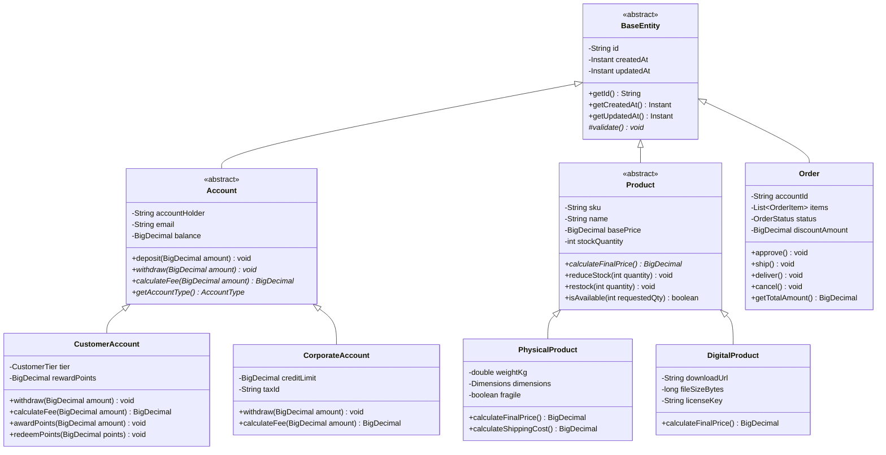
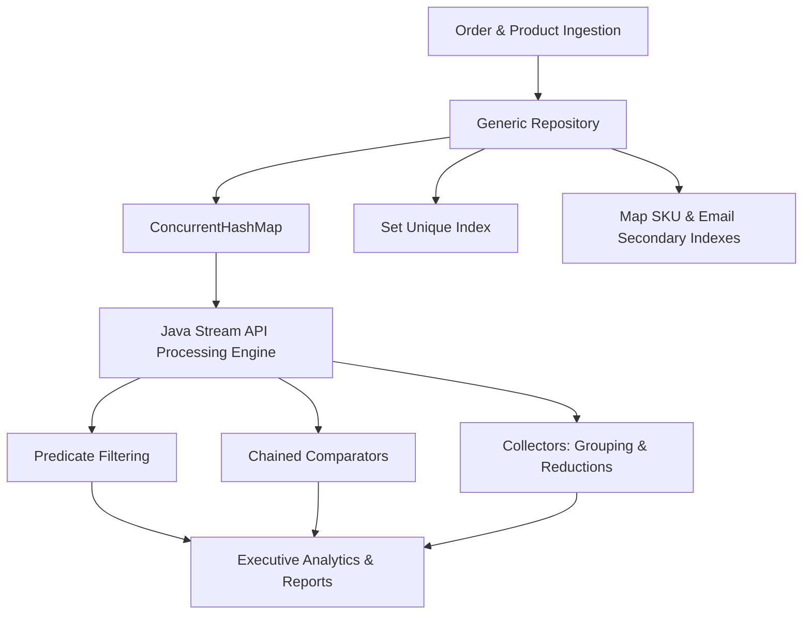
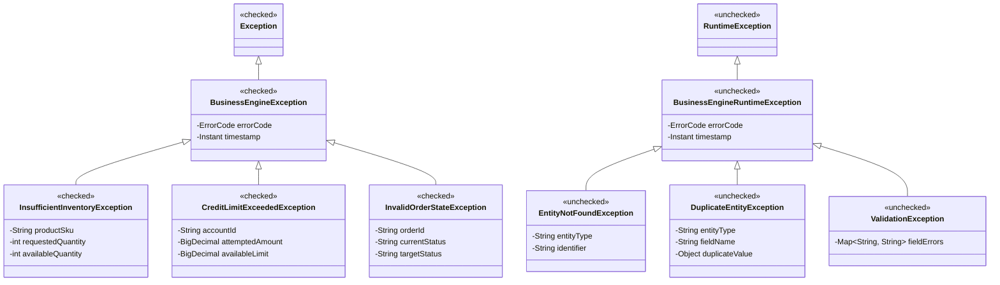

# Core Java Business Management Engine

An enterprise-grade, domain-driven Business Management Engine written in Core Java (Java 21+), showcasing advanced Object-Oriented Programming (OOP) paradigms, the Java Collections Framework (List, Set, Map), functional Stream API processing, a structured checked/unchecked exception hierarchy, and JUnit 5 unit testing.

---

## 🏛️ Architecture & OOP Domain Model



### 1. OOP Principles Implemented
- **Polymorphism & Abstraction**:
  - `Product`: Abstract base class with template method `calculateFinalPrice()` specialized by `PhysicalProduct` (dimensional weight calculation & fragile surcharges) and `DigitalProduct` (zero shipping overhead rebate).
  - `Account`: Abstract financial entity with polymorphic withdrawal semantics. `CustomerAccount` strictly limits withdrawals to available balance while accumulating loyalty points; `CorporateAccount` provides an authorized overdraft credit line and commercial transaction fees.
- **Encapsulation & Defensive Copying**:
  - Direct field mutations are restricted.
  - Mutable collections returned by aggregates (e.g. `Order.getItems()`) are encapsulated via `Collections.unmodifiableList(...)` to prevent unauthorized external state mutation.
- **Java Records (Value Objects & DTOs)**:
  - `Dimensions`: Immutable spatial bounds with positive invariant validation and volume calculation.
  - `OrderItem`: Immutable line item containing SKU, product name, quantity, unit price, and subtotal calculation.
  - `OrderSummary`: Lightweight snapshot record for projection queries.
  - `InventoryReport`: Summary record for executive catalog insights.

---

## 🗃️ Collections Framework & Stream Processing



1. **Generic Collections**:
   - `Repository<T extends BaseEntity, ID>`: Generic contract decoupling persistence mechanics.
   - `InMemoryRepository<T, ID>`: Thread-safe backing store using `ConcurrentMap<ID, T>` for $O(1)$ lookups and `Set<T>` for maintaining entity uniqueness.
   - `ProductRepository`: Secondary SKU indexing `Map<String, Product>` enforcing global uniqueness.
   - `AccountRepository`: Secondary email indexing `Map<String, Account>` preventing duplicate registrations.
   - `OrderRepository`: Relational lookup and status clustering with `Collectors.groupingBy`.
2. **Java Streams & Lambdas**:
   - **Predicate Filtering**: Composable lambdas filtering orders by state, date range, or threshold.
   - **Chained Comparators**: Multi-level sorting (`Comparator.comparing(Order::getTotalAmount).reversed().thenComparing(Order::getCreatedAt)`).
   - **Financial Aggregation**: Accumulating totals using `BigDecimal` stream reductions with rounding modes.
   - **Grouping & Analytics**: Revenue grouped by customer tier, top-$N$ best-selling SKUs, and inventory asset valuation.

---

## ⚠️ Custom Exception Hierarchy



- **Checked Exceptions (`BusinessEngineException`)**: Used for recoverable domain scenarios where callers must provide an alternative workflow (e.g. insufficient inventory, exceeding credit limit, invalid state transitions).
- **Unchecked Exceptions (`BusinessEngineRuntimeException`)**: Used for domain invariants, validation failures, duplicate keys, or entity lookup misses.

---

## 🧪 Comprehensive JUnit 5 Test Coverage

The test suite covers domain logic, concurrency, streams, and error boundaries:

| Test Class | Focus Domain |
|---|---|
| `ProductHierarchyTest` | Inheritance, polymorphic pricing, stock decrement/replenish, dimensions validation |
| `AccountHierarchyTest` | Customer balance, reward tiers, corporate credit overdraft, transaction fees |
| `GenericRepositoryTest` | Generic CRUD, Set uniqueness, duplicate SKU/email constraint enforcement |
| `AnalyticsEngineTest` | Stream sorting, predicate filtering, AOV, tier revenue grouping, inventory valuation |
| `ExceptionHierarchyTest` | Checked/unchecked inheritance, error codes, structured exception attributes |
| `OrderProcessingEngineTest` | Full checkout workflow, tier discount calculations, rollbacks on cancellation |

---

## 🚀 Getting Started

### Prerequisites
- **JDK 17** or higher (tested with JDK 21 and JDK 26)
- **Apache Maven 3.8+**

### Build and Test
```bash
# Run the complete JUnit 5 test suite
mvn clean test

# Package into JAR
mvn clean package
```

### Run Demonstration
```bash
mvn compile exec:java -Dexec.mainClass="com.engine.Main"
```

---

## 📄 License
This project is licensed under the Apache 2.0 License.
